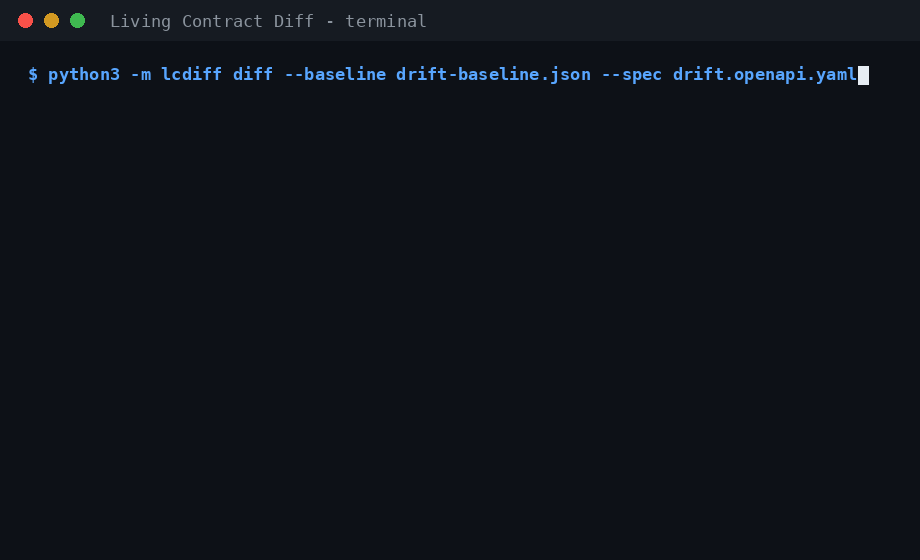

# Living Contract Diff

**Learn what your API actually returns from recorded traffic, then diff that observed contract against your OpenAPI spec to report drift.**



APIs drift: the spec says one thing, the server does another, and nobody notices until a client breaks. Living Contract Diff records a compact, statistics-only baseline from a HAR file and compares it with your declared OpenAPI 3.x contract.

- Python standard library only. No dependencies, no LLM, deterministic.
- Static analysis only — nothing from a HAR or a spec is ever executed.
- Baseline format is **version 2** (2xx responses grouped by exact status code). Version 1 baselines are rejected at load with an explicit "regenerate with `lcdiff observe`" message — never silently misread.

## Privacy — read this honestly

The baseline stores **statistics only**: per-field presence counts and rates, observed type unions with counts, nullability, string format *classes* (date / date-time / uuid / email), and — the one exception below — enum candidate values.

**The designed feature:** for a genuinely low-cardinality field (≤20 distinct values), the candidate values themselves are stored, because they *are* the contract (`status`, `plan`, `currency`, …). If a field ever exceeds 20 distinct values, it is marked `enum_open` and **all** its candidates are dropped, so a high-cardinality field (session tokens, IDs, a planted canary string) leaks **no values at all** into the baseline or any report. This is proven by tests (`test_canary_not_in_baseline`, plus a fix-pass test asserting canaries are also absent from stderr and diff output).

**Layered heuristics on top of the cap** (adversarial fix pass — these reduce, but do not eliminate, the residual risk):

- **Length cap:** string candidates longer than 64 chars are never stored (they still count toward cardinality).
- **Sensitive-field denylist:** values of fields whose final path segment matches `password|passwd|secret|token|api[-_]?key|apikey|auth|session|cookie|credential` (case-insensitive) are **never** stored as candidates — only types/counts/`enum_open`. This is a name heuristic: a token in a field called `data` or `ref` is *not* caught by it.
- **Cross-status cap:** the 20-value cap is re-checked on the union of a field's candidates across all status groups *of the same endpoint*; splitting values across statuses does not smuggle them in. (Splitting across different *endpoints* is **not** caught — see Limitations.)
- **Map-key cap:** field *names* come from map keys, so per parent object, distinct child keys are capped at 50 across observations; beyond that the object is recorded as a map (`map_keys_open` + key count) and no per-key subfields — or key names — are stored.
- **URL path tokens:** path segments that are numeric, decimal, UUID (dashed or 32-hex), or token-like (≥20 chars mixing letters/digits, or hex/base64url-ish) collapse to `{id}` before anything is stored or printed — including in error messages. 4-digit year-like segments (1900–2100) are deliberately *not* collapsed.

**Residual risk, plainly:** a short secret sitting in a low-cardinality, innocuously-named field *will* be stored — that is the designed feature working as intended. The denylist and length cap are heuristics, **not a guarantee**. Treat baselines as internal artefacts if your traffic may contain sensitive low-cardinality values.

## MVP scope (v0)

**In:**
- HAR import (the only traffic source in v0).
- Optional: a directory of `.json` response samples + an endpoint manifest (`--samples-dir` / `--manifest`).
- Inference per endpoint (method + path template, per templating above), **per exact status code within 2xx** (non-2xx grouped by class, recorded but not diffed), per JSON field — recursive, including objects inside arrays. Presence count + rate (array-item denominators count *all* items, including non-object ones), type union (`integer` vs `number` distinguished), nullability, capped enum candidates, format hints, integral-float tracking.
- Baseline as a **versioned JSON file** — chosen over SQLite because it is diffable in git, reviewable in PRs, and trivially portable; the data volume is counts, so a database buys nothing in v0.
- `diff` of a baseline against a local **OpenAPI 3.x spec in JSON or YAML form** (YAML: the subset documented under Limitations, parsed by the stdlib-only `lcdiff/yamlmini.py`), with local `$ref` resolution, deep `allOf` merging, and a union approximation for `oneOf`/`anyOf`. Each documented 2xx status is diffed against the observed group for that same status; spec endpoints/statuses with no observed traffic are listed as **not observed** (not diffed, no fabricated findings, no exit-code effect).
- Diff-side structural matching: baseline endpoints are matched to spec endpoints segment-by-segment (`{param}` positions match any single segment) and merged before diffing, so slug-fragmented traffic (`/articles/my-post`, `/articles/other`) diffs as one endpoint against `/articles/{slug}`. The baseline file itself may stay fragmented.
- Bonus: `diff-baseline` compares two baselines with the same finding codes.

**Explicitly NOT in v1:**
- No live proxy / traffic interception (deferred by design — the proxy is the break-risk: TLS, websockets, streaming, auth).
- No YAML anchors, aliases, merge keys or custom tags in specs, and no multi-document YAML — each is rejected with an explicit named error (see Limitations).
- No request-body inference, no GraphQL/gRPC, no remote `$ref`s, no hosted monitoring or alerting, no GUI.

## Findings

| Code | Severity | Meaning |
|---|---|---|
| `REQUIRED_MISSING` | breaking | Spec-required field observed below the presence threshold (default 0.99, `--required-threshold`) or never. Evidence carries the exact rate and the *parent instance* count as denominator. No cascade: children of a never-observed parent object are not separately reported. Special case: a required field whose parent array was observed but always empty is reported at **warning** severity as *unverifiable-because-empty*. |
| `TYPE_MISMATCH` | breaking | Observed type outside the spec type. Spec `number` accepts observed `integer`; observed **integral floats** (`1.0`) satisfy spec `integer` (documented deviation, mainstream-validator behaviour); observed `null` only if the spec is nullable (3.0 `nullable: true` or 3.1 `type: [..., "null"]`). A single mismatched instance in ≥20 observations is downgraded to warning with the count/rate in evidence. |
| `UNDOCUMENTED_FIELD` | warning | Field observed in traffic that the spec does not document. Not raised under `additionalProperties` maps (map values are type-checked against the AP schema instead), free-form objects (`type: object` with no properties — additionalProperties defaults to allowed), map parents, or `oneOf`/`anyOf` variants. A wholly undocumented **endpoint** collapses into a single warning listing its fields. An observed-but-undocumented 2xx **status** surfaces its fields once, scoped to that status. |
| `ENUM_GROWTH` | warning | Observed values beyond the documented enum. For an `enum_open` field it fires only when provably exceeded: `enum_open` implies ≥21 distinct observed values, so it fires iff the spec enum has fewer than 21 values. |

**Sample-size guard:** endpoints (per status group) with fewer than **5** observed JSON responses have *all* their findings downgraded to warning with a `low_sample` flag in the evidence — a 1–3 response capture cannot break your CI. The report header states per-endpoint sample sizes (also in the JSON report as `endpoint_samples`, alongside a `not_observed` section).

Every finding carries endpoint + field path + evidence counts.

**Exit codes:** `0` = no breaking drift · `1` = breaking drift found · `2` = usage/tool error. An unreadable, malformed, truncated or structurally invalid input always exits `2` with an explicit `error: …` message — never a traceback, and never a clean report. Non-strict JSON (`NaN`/`Infinity`) is rejected; duplicate keys in specs/baselines are an error (in HAR bodies they are last-wins and counted into a baseline `warnings` note).

## Usage

```bash
# 1. Record traffic (browser dev-tools / proxy export) as traffic.har, then:
python3 -m lcdiff observe --har traffic.har --out baseline.json

# 2. Diff the baseline against your spec (JSON or YAML; the format is
#    chosen by extension — .json/.yaml/.yml — or sniffed from content):
python3 -m lcdiff diff --baseline baseline.json --spec openapi.json
python3 -m lcdiff diff --baseline baseline.json --spec openapi.yaml
echo $?   # 1 if breaking drift

# Machine-readable report (findings + not_observed + endpoint_samples):
python3 -m lcdiff diff --baseline baseline.json --spec openapi.json --format json

# Options:
#   --required-threshold 0.95   presence threshold for REQUIRED_MISSING (0 < x <= 1)
#   --ignore-endpoint 'GET /health' --ignore-endpoint '*/metrics'
#                                exclude endpoints by glob (repeatable; matched
#                                against "METHOD /path" and the path template)

# Bonus: baseline vs baseline
python3 -m lcdiff diff-baseline --old baseline.old.json --new baseline.json
```

Sample output (from `examples/real_world/`, a real local capture; note the sample-size guard at work — the capture has only 3 product responses, so the one deliberate drift is a warning):

```
Living Contract Diff
====================
Endpoint sample sizes (JSON responses per status):
  GET /health  200: 1
  GET /products/{id}  200: 3
[WARNING] REQUIRED_MISSING  GET /products/{id}  field=sku
    evidence: {'present_count': 0, 'parent_count': 3, 'presence_rate': 0.0, 'threshold': 0.99, 'status': '200', 'note': 'never observed in 3 parent instance(s)', 'low_sample': True, 'sample_size': 3}
Summary: 1 finding(s), 0 breaking, 1 warning
```

Robustness: empty bodies, 204s and non-JSON bodies are skipped without crashing; undecodable/invalid bodies *for JSON content types* are an explicit INCOMPLETE error, not a silent skip; huge payloads, unicode and deeply nested JSON (recursion is depth-capped, and recursive `$ref`s — including branching ones — resolve via an ancestry placeholder) are handled; truncated JSON is an explicit error (exit 2). Text reports escape control characters in names, so a hostile field name cannot forge report lines.

## Limitations

- **⚠ Sparse fieldsets (`?fields=`):** if your API returns different field subsets depending on a query parameter (e.g. `?fields=id,name`), a HAR mixes those subsets into one endpoint and presence rates are meaningless blends. **This cannot be detected from a HAR** — request query strings are not part of the observed contract. Record separate captures per fieldset if you use them.
- **Cross-endpoint enum split:** the candidate cap is enforced per endpoint (across its status groups). The same field leaking distinct values across *different endpoints* is not union-checked.
- **Token-templating heuristics:** short or pure-letter path segments (slugs, usernames, other short PII) can persist verbatim in a baseline template. Diff-side structural matching means they rarely need to be stored for diffing to work, but they *are* stored. Review templates before committing a baseline from sensitive traffic.
- **YAML specs: a documented subset, not all of YAML.** Supported: block mappings/sequences (incl. compact `- key: value` and indentless sequences), flow `{..}`/`[..]` (nested, mixed with block), plain/single-quoted/double-quoted scalars, block scalars `|`/`>` with chomping and indent indicators, comments, multi-line plain scalars, quoted keys. Scalar typing follows the YAML 1.2 core schema and mirrors JSON where they meet (`3.10` → float `3.1` exactly as in JSON; `1.0` stays a float distinct from `1`; timestamps stay strings; `012` is a string; booleans are only the six core spellings `true`/`True`/`TRUE`/`false`/`False`/`FALSE` — any other casing, and `yes`/`no`/`on`/`off`, are strings). Rejected with a named error, never silently mis-parsed: anchors (`&a`), aliases (`*a`), merge keys (`<<`), custom tags, directives (`%YAML`/`%TAG`), explicit `?` keys, plain scalars starting with a reserved indicator (`@`/`` ` ``) or containing a `: ` mapping indicator, multi-document files, tabs in indentation or used as separation (tabs inside block-scalar *content* are fine), unresolvable indentation, and duplicate mapping keys (as strict as the JSON path — keys that are equal as Python numbers, e.g. `1:`/`1.0:`/`true:`, are duplicates; `1:` and `'1':` stay distinct). Response codes that collide after normalisation (YAML `200:` vs `'200':`) are likewise a named error, never a silent overwrite. Limits: 32 MiB document, nesting depth 200 (same boundary in block and flow syntax), 2,000,000 nodes — and every mapping entry (key and value), sequence item and scalar counts toward the node limit, including empty/null values. Anchors are rejected rather than expanded, so alias-bomb inputs fail instantly.
- **Local `$ref`s only**; remote/file refs exit 2. `oneOf`/`anyOf` are a documented approximation (union of properties; required = required in *all* variants; per-field type = union). `not`, discriminators and pattern properties are not modelled.
- **`$ref` fan-out cost (pre-existing, both formats):** heavily cross-referenced specs expand multiplicatively at resolve time — a synthetic 500×500-ref spec materialises ~250k fields and takes ~4 s. Real-world specs are nowhere near this, but there is no separate expansion budget yet.
- Presence denominators assume one structural shape per path; a field path reused with different parent shapes merges their counts.
- Duplicate keys in HAR bodies are last-wins (counted in a baseline `warnings` note), matching common JSON parser behaviour; they are a hard error only in specs/baselines.
- Baseline-vs-baseline diff is a bonus with adapted semantics (new field = `UNDOCUMENTED_FIELD`, vanished high-rate field = `REQUIRED_MISSING`).

## Tests

```bash
python3 run_tests.py        # or: python3 -m unittest discover -s tests
```

231 tests: the original 31 over a hand-built fixture corpus in `tests/fixtures/` (clean API, one planted fault per fixture — each finding type twice, in nested-object and array-item shapes — sparse fields, integer/float discipline, canary privacy, enum cap, 204/empty/non-JSON, `$ref`/`allOf`, malformed inputs) plus 67 fix-pass regression tests in `tests/test_fixpass.py` covering every adversarial-review finding (privacy caps, per-status diffing, slug aggregation, maps/free-form/variants, sample guard, strict error discipline, GitHub Action consumer simulation, …) plus 72 YAML tests in `tests/test_yaml.py`: an equivalence corpus (every JSON fixture spec has a YAML twin — 14/14 produce typed-identical structures and identical CLI reports/exit codes), scalar-typing pins, syntax-feature and named-rejection tests, safety-limit tests, and differential fuzz regressions against PyYAML (used in tests only as an oracle; nothing under `lcdiff/` imports it), plus 61 YAML fix-pass regression tests in `tests/test_yaml_fixpass.py` (one per finding from the three-reviewer attack on the YAML parser: empty sequence items, response-code smuggling, folded block scalars vs the PyYAML oracle, node-count honesty, timing bounds, depth boundary parity, …). See `ANALYSIS.md` for measured results and the fix-pass before/after.

## GitHub Action

`action.yml` in this repo is a composite action that runs the diff in CI mode against a committed baseline + spec and appends the report to the job summary. It puts the action's own checkout on `PYTHONPATH` (via `github.action_path`) so the `lcdiff` package resolves, while your `baseline`/`spec` inputs stay relative to *your* workspace. Using it from another repo (once published):

```yaml
- uses: RakTikoo/living-contract-diff@v0
  with:
    baseline: contract/baseline.json
    spec: openapi.json
```

A self-contained example workflow that needs no marketplace action is in `examples/workflow.yml` — it checks out this tool, runs `observe`-free CI diffing, fails on new breaking drift (exit 1), and writes the report to `GITHUB_STEP_SUMMARY`.

## License

MIT — see `LICENSE`.


---

**More from this workshop:** [SkillScan](https://github.com/RakTikoo/skillscan) · [KiCad Preflight](https://github.com/RakTikoo/kicad-preflight) · [Expiry Radar](https://github.com/RakTikoo/expiry-radar) · [CI Command Truth](https://github.com/RakTikoo/ci-command-truth) · [PhantomDep PR Gate](https://github.com/RakTikoo/phantomdep-pr-gate) · [Stranger Suite](https://github.com/RakTikoo/stranger-suite) · [Handoff Reconciler](https://github.com/RakTikoo/handoff-reconciler)
